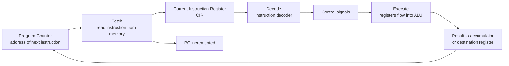
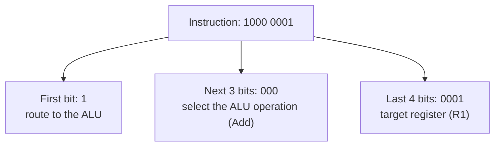
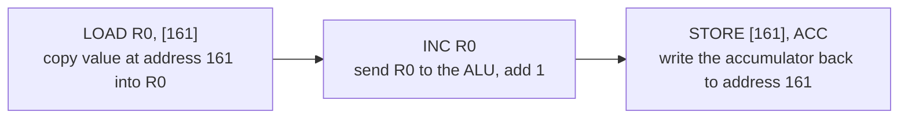
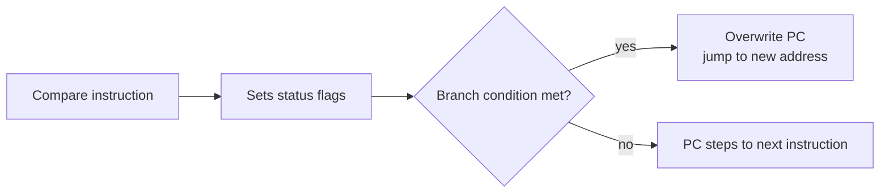

# CPU Architecture & How Processors Work

## Evolution and Physical Packaging

Two chips, 40 years apart:

| | MOS 6502 (Apple IIe, 1983) | Apple M1 (modern SoC) |
|---|---|---|
| Transistors | 4,528 | ~16 billion |
| Architecture | 8-bit | 64-bit |
| Clock | ~1 MHz | ~3.2 GHz |
| Calculations per second | ~430,000 | ~3 trillion |
| On-chip cache | None. 1980s DRAM was about as fast as the CPU clock | L1 / L2 / L3 |

### Physical Chip Layers (top to bottom)

1. Heat spreader (protective cover): conducts and dissipates heat away from the silicon.
2. Integrated circuit (IC / die): the functional silicon, etched with billions of transistors and wires.
3. Interposer: the bottom substrate, with thousands of microscopic connection points routing signals between the die, DRAM, and motherboard.

## The CPU Mental Model (Bookshelf Analogy)

| Analogy | Hardware | Role |
|---|---|---|
| Bookshelves | SSD / flash storage | Long-term, non-volatile. Huge capacity, slowest to access |
| Book cart | DRAM (main memory) | Short-term working memory. Cleared on power-off, limited capacity, much faster than SSD |
| Open book on table | CPU cache (L1/L2/L3) | Very small, ultra-fast SRAM on the chip holding active instructions and data |
| Sheet of paper | Registers | Tiny slots inside the core for numbers currently being processed. Instant access |
| Calculator | ALU (Arithmetic Logic Unit) | Executes binary math and logic, then outputs to the accumulator (or destination register) |

### Inside a Loaded Program ("the book")

- **Instructions:** sequential steps, like a recipe, telling the CPU what to do.
- **Data:** values stored at specific memory addresses, like ingredients, which the instructions operate on.

## The Fetch-Decode-Execute Cycle

Every instruction passes through three core stages, paced by the system clock. Memory and writeback stages are added when reading or writing RAM.

### Fetch

The control unit reads the address held in the Program Counter (PC), fetches the binary instruction at that address, and places it in the Current Instruction Register (CIR). The PC is then incremented to point to the next instruction.

### Decode

The instruction decoder reads the bits in the CIR and translates them into electrical control signals that activate exactly the circuits needed.

Example breakdown of `1000 0001`:

ALU operation codes used in this example: `000` add, `001` subtract, `010` multiply, `011` increment, `100` bitwise AND, `101` compare.

### Execute

Using the decoder's control signals and precisely timed electrical pulses, values flow from the selected registers into the ALU. The ALU computes the result and writes it to the accumulator (or destination register). The cycle then repeats for the updated PC.

## Single-Core (6502) vs Modern Superscalar Core (Apple M1)

### Classic 6502 Core (sequential)

- One Program Counter, CIR, decoder logic, and data path controller.
- One ALU (inputs ALU A and ALU B, plus the accumulator), a stack pointer, and X/Y index registers.
- All connected by shared address and data buses.
- Executes one instruction at a time.

### Modern M1 Performance Core (pipelined and superscalar)

- **Separate L1 caches:** 64 KiB instruction cache and 64 KiB data cache, each paired with a Translation Lookaside Buffer (TLB) for fast address translation.
- **Branch predictor:** guesses which way `if` and loop branches will go before they finish, so the pipeline stays full.
- **Pipelining and out-of-order execution:** fetch, decode, and execute overlap across many instructions at once, like an assembly line, using a decode queue and a rename and reorder buffer.
- **Wide parallel hardware:** 4-way instruction decoders, 32 general-purpose registers, dedicated Advanced SIMD and FP registers, and multiple execution units (branch, several ALUs, multiply/divide, MAC/FP, and load/store units with load/store buffers).

## Random Notes

### ALU Operations (binary)

- **Arithmetic:** add, subtract, multiply, increment (`+1`), decrement (`-1`).
- **Bitwise shifts:**
  - Left shift (`<< 1`) appends a `0` on the right, which multiplies by 2 in binary.
  - Right shift (`>> 1`) divides by 2.
- **Logical:** `AND`, `OR`, `XOR`, `NOT`.
- **Comparisons:** compares two registers (e.g. `R0 == R1`) and sets hardware status flags (Zero/Equal, Less Than, Greater Than). Conditional branches read these flags.

### How `i++` Runs in Assembly

### Control Flow

- **Program Counter (PC):** also called the Instruction Pointer or Instruction Address Register. It holds the address of the next instruction to execute.
- **Jumps and conditional branches:** loops (`for` / `while`) and `if` statements compile down to a comparison instruction followed by a jump or branch instruction. The jump overwrites the PC so execution leaps forward or backward instead of stepping sequentially.

### Machine Code vs Assembly

CPUs execute raw binary machine code. Assembly is just the human-readable text form of those same instructions.

### ASIC vs FPGA

- **ASIC (Application-Specific Integrated Circuit):** hardware permanently wired for one task, such as Bitcoin miners or video encoders.
- **FPGA (Field-Programmable Gate Array):** reconfigurable hardware logic blocks.
- Neither uses a general-purpose fetch-decode-execute cycle. Data streams directly through fixed execution pipelines. That makes them very fast and power-efficient for one workload, but inflexible.

### RISC vs CISC

| | RISC | CISC |
|---|---|---|
| Stands for | Reduced Instruction Set Computer | Complex Instruction Set Computer |
| Examples | ARM, Apple M1 (~354 instructions) | x86-64 Intel / AMD (thousands of instructions) |
| Instructions | Simple and uniform, typically one clock cycle each | Complex multi-step operations, variable clock cycles |
| Hardware | Relies on smart compilers to sequence instructions | Needs heavier hardware decoding |
| Strength | High energy efficiency, ideal for mobile SoCs | Powerful single instructions |
