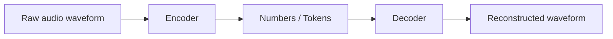
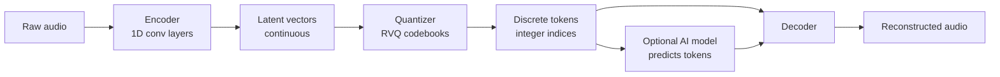
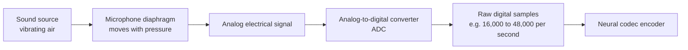
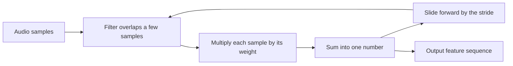
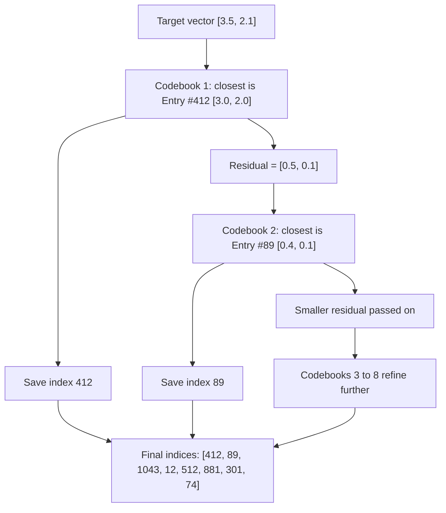
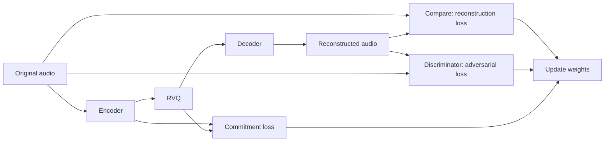

# Neural Audio Codecs

## What is a Neural Audio Codec?

A neural audio codec is an audio compression engine that works using deep learning. It takes in a large file of raw audio, shrinks it to a tiny sequence of numbers (codes) for storage or transmission, and then recreates the original sound from those numbers on the other side.

## Structure of a Neural Audio Codec

### The Encoder (Compressor)

- **Made up of:** A deep neural network built from 1D convolutional layers.
- **Acts as:** A feature extractor.
- **How it works:** The encoder takes a window of raw samples and squeezes it into a shorter sequence called a *latent vector*. Each latent vector is a summary representation of the pitch, volume, timbre, and content for that frame.

### The Codebook / Quantizer (The Translator)

- **Made up of:** A lookup table (directory) filled with learned vector representations, trained using Residual Vector Quantization (RVQ).
- **What it does:** Converts smooth, continuous vectors into discrete, fixed integers.

### The Brain (The AI Model)

This part is optional and is used in generative setups such as speech or music models. The AI model works on the discrete integer codebook indices (the quantized numbers) produced by the quantizer. It can predict, continue, or generate sequences of these tokens, much like a language model predicts text.

### The Decoder

The decoder reverses the whole process. It takes the quantized discrete array and converts it back into a raw audio waveform.

### How Sound Travels Through a Microphone

Before any of the codec steps happen, the sound has to be captured and digitized.

## Random Notes

### 1D Convolutional Layer

A 1D convolutional layer is like a small sliding window (called a kernel or filter) with a fixed width that moves along the audio from left to right. As it slides, it looks at a tiny snippet of the audio, performs a calculation, writes down a new feature, and takes a step forward.

- **The Filter (Weights):** The filter contains a set of learned numbers (weights) that detect specific patterns or templates in the audio wave.
- **The Dot Product (Multiplication and Sum):** At any given position, the filter overlaps with a few audio samples. It multiplies each audio sample by its corresponding filter weight and adds them all together into a single summary number.
- **Sliding (The Stride):**
  - The filter shifts across the audio one step (or multiple steps) at a time.
  - At each new position, it repeats the dot product calculation.
  - This sliding action creates a brand-new, shorter line of numbers that maps out where the templates were found.

### Residual Vector Quantization (RVQ)

Quantization means replacing a continuous vector with the closest entry from a lookup table (a codebook), so that only the entry's index number has to be stored. The problem is that one codebook would need an enormous number of entries to describe audio accurately. RVQ solves this by using several small codebooks in a chain. Each codebook only encodes what the previous ones got wrong (the residual).

Let's say our target vector = [3.5, 2.1]. Overall, audio codecs have around 1 to 32 codebooks, depending on the target bitrate, audio quality, file size, and more. A popular default is 8 codebooks. Adding more codebooks adds more quality but forces the AI to process more text-like tokens per second.

- **Codebook 1 (The Coarse Outline):** It looks inside Codebook 1 (2048 entries). 2048 is not a fixed number of entries; it depends on the architecture. For example, 2^10 = 1024 is used by Meta's EnCodec and SoundStream, and 2^11 = 2048 is used by Kyutai's Mimi or Descript's DAC. Codebook 1 finds the closest match to the target vector [3.5, 2.1] and says "Entry #412 is the closest match we have: [3.0, 2.0]". The index number *412* is saved. The leftovers (the residual) are what the match failed to capture, and they are passed on to the next codebook.

  Target [3.5, 2.1] - Match [3.0, 2.0] = [0.5, 0.1]

- **Codebook 2 (The Medium Details):** It does not see the original target, only the residual [0.5, 0.1]. It looks into Codebook 2 and says "Entry #89 is the closest match: [0.4, 0.1]". The index number 89 is saved, and a smaller residual is passed on.

  Residual [0.5, 0.1] - Match [0.4, 0.1] = [0.1, 0.0]

- **Codebooks 3 to 8 (The Fine Details):** Each one repeats the same step on whatever error is left, so the error keeps shrinking.

  Final Codebook Indices = [412, 89, 1043, 12, 512, 881, 301, 74]

**The whole example in one table:**

| Step | Input | Matched entry | Saved index | Residual (passed on) |
|---|---|---|---|---|
| Codebook 1 | [3.5, 2.1] | [3.0, 2.0] | 412 | [0.5, 0.1] |
| Codebook 2 | [0.5, 0.1] | [0.4, 0.1] | 89 | [0.1, 0.0] |
| Codebooks 3 to 8 | [0.1, 0.0] | closest entries at each step | 1043, 12, 512, 881, 301, 74 | keeps shrinking toward zero |

**Decoding:** The decoder looks up each saved index in its codebook and adds the entries together. Using just the first two codebooks from the example: [3.0, 2.0] + [0.4, 0.1] = [3.4, 2.1], which is already very close to the original target [3.5, 2.1]. The remaining codebooks close the rest of the gap.

**Why multiple codebooks?** Fitting all the entries into one codebook would make the computer run out of memory almost instantly. By using 8 smaller codebooks of 2048 entries each (8 x 2048 = 16,384 entries stored), the model can mix and match entries to represent an astronomically large number of unique combinations (2048^8) with far less memory and compute.

## Bitrate Calculation

The bitrate follows directly from the codebook setup:

bitrate = frames per second x number of codebooks x bits per index

For example, with 75 frames per second, 8 codebooks, and 1024 entries per codebook (10 bits each): 75 x 8 x 10 = 6,000 bits per second, or 6 kbps. Using fewer codebooks at inference time gives a lower bitrate and lower quality, which is how many codecs support multiple bitrates from a single model.

## How the Codec Is Trained

The whole system (encoder, quantizer, decoder) is trained end to end, usually with these losses:

- **Reconstruction loss:** Compares the output waveform or spectrogram to the original.
- **Adversarial loss:** A discriminator network tries to tell real audio from reconstructed audio, which pushes the decoder toward realistic sound.
- **Quantization / commitment loss:** Keeps the encoder outputs close to the codebook entries so the quantizer stays stable.

